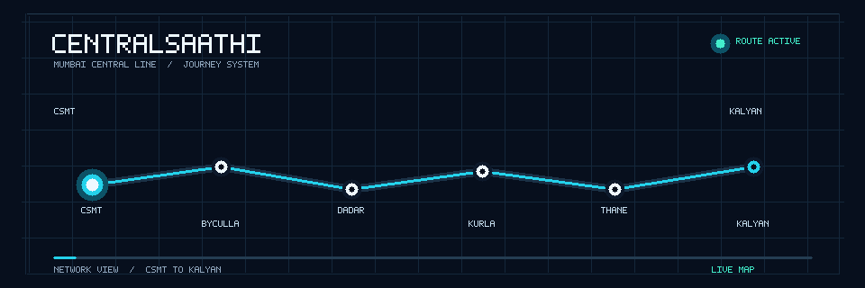
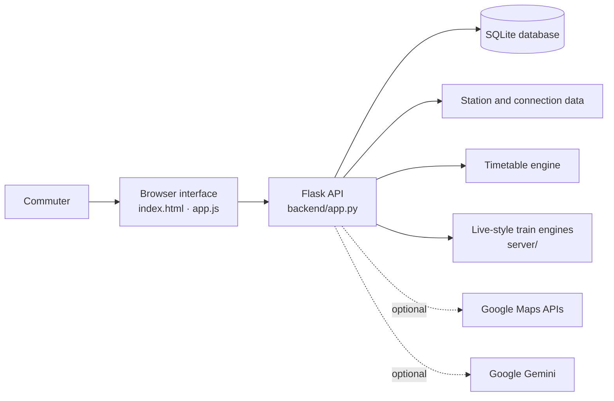

<div align="center">
  
  <h1>CentralSaathi</h1>
  <p><strong>A clearer way to explore Mumbai’s Central Line.</strong></p>
  <p>Route planning · Station connectivity · Train information · Commuter insight</p>
  <p>
    
    
    
    
    
  </p>
  <p>
    <a href="#the-idea">The idea</a> ·
    <a href="#what-you-can-explore">Features</a> ·
    <a href="#run-it-locally">Run it</a> ·
    <a href="#api-at-a-glance">API</a> ·
    <a href="#team-and-ownership">Team</a>
  </p>
</div>

---

## Table of contents

1. [The idea](#the-idea)
2. [What you can explore](#what-you-can-explore)
3. [Architecture](#architecture)
4. [Technology](#technology)
5. [Run it locally](#run-it-locally)
6. [Data and branch layout](#data-and-branch-layout)
7. [API at a glance](#api-at-a-glance)
8. [Repository map](#repository-map)
9. [Team and ownership](#team-and-ownership)
10. [Contributing](#contributing)
11. [Troubleshooting](#troubleshooting)
12. [Project goals](#project-goals)

---

## The idea

Mumbai’s local network is part of everyday life for millions of people, yet planning a trip still means juggling slow and fast trains, junction changes (Dadar, Kurla, Thane, Kalyan), mega blocks, and last-minute delays. CentralSaathi brings that journey context into one place: explore stations and connections, compare train options, estimate fares, and find commuter information without jumping between separate tools.

The project focuses on the **Central Line**, connecting CSMT with the suburban corridors toward Kasara and Karjat. Under the hood it models the line as a **network of stations (nodes) and rail connections (edges)**, and layers route finding, timetable lookup, fares, and analytics on top. It combines a browser interface with a Python API, local data engines, and optional Google Maps and Gemini integrations.

<p align="center">
  
</p>
<p align="center"><sub>Illustrative route animation — the moving marker is a schematic, not a live GPS feed.</sub></p>

<p align="center">
  
</p>

## What you can explore

| Capability | What it brings together |
|---|---|
| **Station and route discovery** | Search stations and explore route options, slow/fast choices, interchange junctions, and journey context. |
| **Station connectivity data** | Coordinates, distances, platforms, junctions, and interchange links (Harbour, Outstation). |
| **Train and timetable tools** | Search train options and look up first and last services when schedule data is available. |
| **Fare estimates** | Compare estimated fares between stations. |
| **Railway map experience** | Explore the line on a map; Google Maps route geometry is optional. |
| **Train movement view** | Follow live-style train movement and service context in the interface. |
| **Station facilities** | Lifts, escalators, medical rooms, ATVM kiosks, water points, and platform layout. |
| **Commuter reports and alerts** | Review railway updates, mega block and advisory notices, and submit or verify crowd reports. |
| **Analytics** | Surface punctuality, delay distribution, crowd, and network summaries through the analytics endpoints. |
| **AI travel assistant** | Ask a commuter question through the Gemini-powered endpoint when a key is configured. |

> **Data note:** schedule-backed results depend on the timetable dataset being present. The timetable engine looks for `server/data/official_timetable_data.json`; that file is not currently published on `main` or `data_f`.

## Architecture



**How a typical request flows:** the browser calls an `/api/...` endpoint, Flask resolves it using the station/connection data and timetable engine, reads or writes SQLite where needed (for example crowd reports), and returns JSON to the interface. Maps and Gemini are only called when their keys are configured.

## Technology

| Layer | Tools |
|---|---|
| **Interface** | HTML, CSS, JavaScript |
| **API and application logic** | Python, Flask |
| **Storage** | SQLite, with JSON-backed station and timetable inputs |
| **Analytics** | Pandas, NumPy, Matplotlib, Plotly |
| **Scraping** | Requests, BeautifulSoup4 |
| **External integrations** | Google Maps and Gemini, both optional |

## Run it locally

### Prerequisites

- Python 3.10 or newer
- Node.js and npm for the repository’s npm scripts
- Git

### 1. Get the code and create a virtual environment

```bash
git clone https://github.com/Manish-kumbhar07/central-saathi-mini-project-.git
cd central-saathi-mini-project-
python -m venv .venv
```

Activate the environment:

```bash
# macOS / Linux
source .venv/bin/activate
```

```powershell
# Windows PowerShell
.venv\Scripts\Activate.ps1
```

### 2. Install the packages

Python packages used by the Flask application:

```bash
python -m pip install flask python-dotenv numpy pandas matplotlib plotly requests beautifulsoup4
```

Node packages used by the project scripts and frontend tooling:

```bash
npm install
```

### 3. Configure optional integrations

Copy `.env.example` to `.env` and add keys only for the services you plan to use.

```bash
# macOS / Linux / Git Bash
cp .env.example .env
```

```powershell
# Windows PowerShell
Copy-Item .env.example .env
```

| Variable | Used for | Required? |
|---|---|---|
| `VITE_GOOGLE_MAPS_API_KEY` | Browser map experience | Optional |
| `GOOGLE_MAPS_API_KEY` | Server-side Google route requests | Optional |
| `GEMINI_API_KEY` | AI assistant and schedule verification | Optional |
| `GEMINI_MODEL` | Gemini model selection | Optional; defaults in the application |
| `DJANGO_SECRET_KEY` | Separate Django scaffold only | Only if running that scaffold |

> **Security:** restrict the browser Maps key to the app’s allowed referrers. Keep server credentials private and never commit `.env` to source control.

### 4. Start CentralSaathi

```bash
npm run dev
```

The `npm run dev` and `npm start` scripts launch Flask at **http://localhost:3000**. You can also start Flask directly:

```bash
python -m backend.app
```

The repository also contains `server.js` as a separate Express entry point; it is not used by those npm scripts.

### 5. Check that it works

```text
http://localhost:3000/api/health
http://localhost:3000/api/route?origin=CSMT&destination=KYN
```

### Other ways to run

```bash
# Standalone Python version (CLI / built-in server)
python3 central_saathi.py --serve --port 8080
python3 central_saathi.py --origin TNA --dest CSMT --time 08:30
```

## Data and branch layout

The station and connection datasets are maintained on the **`data_f`** branch:

- `data/central_line_stations.json`
- `data/central_line_connections.json`

To bring those two files into a local `main` checkout without switching branches:

```bash
git fetch origin data_f
git restore --source origin/data_f --worktree -- data/central_line_stations.json data/central_line_connections.json
```

The timetable engine separately expects `server/data/official_timetable_data.json`. Add a project-approved timetable dataset at that path to enable schedule-backed train results.

## API at a glance

The Flask app exposes JSON endpoints for the main commuter workflows.

| Method | Endpoint | Purpose |
|---|---|---|
| `GET` | `/api/health` | Check application health |
| `GET` | `/api/stations` | List stations |
| `GET` | `/api/route` | Find route options |
| `GET` | `/api/trains/search` | Search train options |
| `GET` | `/api/timetable/first-last` | Find first and last train options |
| `GET` | `/api/fare` | Estimate a fare |
| `GET` / `POST` | `/api/disruptions/crowd-reports` | Read or submit commuter reports |
| `GET` | `/api/analytics` | Retrieve network and service analytics |
| `POST` | `/api/ai/ask` | Ask the optional AI assistant |

Example:

```text
http://localhost:3000/api/route?origin=CSMT&destination=KYN
```

## Repository map

```text
.
├── api/                       # Serverless API entry point
├── backend/
│   ├── app.py                 # Flask API and local web entry point
│   ├── database.py            # SQLite setup and data access
│   ├── timetable_engine.py    # Train and route logic
│   ├── analytics_engine.py    # Service and network analytics
│   ├── railway_analytics.py   # Advanced commuter analytics
│   ├── scrapers.py            # Railway advisory scraping
│   └── railway_scraper.py     # Official railway scraper module
├── server/
│   ├── live_telemetry.py      # Telemetry and speed/delay simulation
│   ├── live_tracker.py        # Train position and movement logic
│   ├── live_trains_engine.py  # Train search and timetable engine
│   ├── train_tracker.py       # Active fleet tracker
│   ├── route_engine.py        # Route planning logic
│   ├── railway_news.py        # Disruptions, mega blocks, railway news
│   ├── station_facilities.py  # Station facilities and platform layout
│   ├── railway_db.py          # SQLite relational schema and DB engine
│   ├── timetable_importer.py  # Timetable import utilities
│   └── timetable_validator.py # Timetable consistency checks
├── data/                      # Station and connection datasets
├── public/assets/             # Railway illustrations and imagery
├── central_saathi_project/    # Separate Django scaffold
├── index.html                 # Browser interface
├── app.js                     # Frontend behavior
├── server.js                  # Separate Express entry point
├── app.py                     # Standalone analytics prototype (Streamlit)
├── central_saathi.py          # Standalone Python app / CLI
├── package.json               # Project scripts
├── Procfile                   # Deployment process definition
├── vercel.json                # Vercel routing and rewrites
├── .env.example               # Safe environment-variable template
└── README.md
```

## Team and ownership

CentralSaathi was built as a collaborative project. The work spans product design, frontend development, backend services, server-side train tools, and railway data.

### Ownership at a glance

| Area | Owner(s) | Scope |
|---|---|---|
| **Backend** | Manish, Jayesh | Timetable engine, analytics, database layer, scrapers |
| **API** | Manish | REST endpoints and API gateway |
| **Server** | Jayesh, Arnav, Viraj | Server runtime, live tracking engines, deployment config |
| **Data** | Viraj, Arnav | Station/connection datasets, timetable data, databases, importer and validator |
| **Frontend** | Manish | User interface, client-side logic, and assets |

### Manish — Product experience, frontend, backend, and API

- Shaped the commuter-facing experience, including the main page, interaction flow, and visual assets.
- Developed frontend behavior and integrated it with the project’s API routes.
- Contributed to API and application integration across the project.
- Co-owns the Python backend with Jayesh, covering the timetable, database, analytics, and scraping logic that powers the API.
- **Key areas:** `index.html`, `app.js`, `server.js`, `metadata.json`, `public/assets/`, API work in `backend/app.py`, and shared backend modules in `backend/`.

### Jayesh — Backend and server engineering

- Worked on the Python backend, including timetable, database, analytics, and railway-scraping components.
- Collaborated on the application’s server runtime and the services that support commuter features.
- Helped connect backend data and route logic to user-facing features.
- **Key areas:** `backend/database.py`, `backend/timetable_engine.py`, `backend/analytics_engine.py`, `backend/railway_analytics.py`, `backend/scrapers.py`, and `backend/railway_scraper.py`.

### Arnav — Train systems, server, and data engineering

- Built and extended train movement, active-train, and route-planning components for the Central Line.
- Added timetable import and validation tools to help prepare and check schedule data.
- Co-owns the `data/` folder, collaborating with Viraj on station and connection data.
- **Key areas:** `server/live_tracker.py`, `server/live_trains_engine.py`, `server/route_engine.py`, `server/timetable_importer.py`, `server/timetable_validator.py`, and shared station-data work.

### Viraj — Station and connectivity data, and server support

- Worked on the Central Line station and connection datasets used by route and map features.
- Contributed station attributes such as coordinates, distances, platforms, junctions, and interchange links.
- Collaborated with Arnav on preparing and checking railway data, and contributes to the server-side engines alongside Jayesh and Arnav.
- **Key areas:** `data/central_line_stations.json`, `data/central_line_connections.json`, shared timetable-data work, and the `server/` folder.

## Contributing

Suggested commit prefixes keep the history easy to read and show who did what:

| Prefix | Area | Typical contributors |
|---|---|---|
| `backend:` | Python backend logic | Manish, Jayesh |
| `api:` | REST endpoints and gateway | Manish |
| `server:` | Server engines and deployment | Jayesh, Arnav, Viraj |
| `data:` | Datasets, databases, importer/validator | Viraj, Arnav |
| `frontend:` | UI, client logic, assets | Manish |
| `docs:` | README and documentation | Anyone |

Example:

```bash
git add README.md
git commit -m "docs: refresh project README"
git push origin main
```

## Troubleshooting

| Problem | What to try |
|---|---|
| Station list or routes come back empty | The datasets live on `data_f`. Run the `git restore` command in [Data and branch layout](#data-and-branch-layout). |
| Train search returns no schedule results | Add the timetable dataset at `server/data/official_timetable_data.json`. |
| Map does not load | Check that `VITE_GOOGLE_MAPS_API_KEY` is set and the key allows your local referrer. |
| AI assistant does not answer | Set `GEMINI_API_KEY` in `.env` and restart the server. |
| `ModuleNotFoundError` on start | Activate your virtual environment and re-run the `pip install` command above. |
| Port 3000 is already in use | Stop the other process, or run Flask directly on another port if your setup allows it. |

## Project goals

- Make Central Line station and journey information easier to explore.
- Keep route, train, and fare tools in one commuter-focused interface.
- Connect data engineering with practical features people can understand.
- Build the project collaboratively and make each teammate’s contribution visible.

---

<div align="center">
  <strong>Built with care for Mumbai’s local-train commuters.</strong><br />
  CentralSaathi · Team project
</div>
