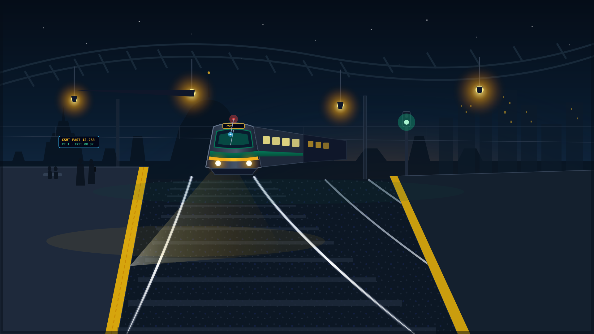
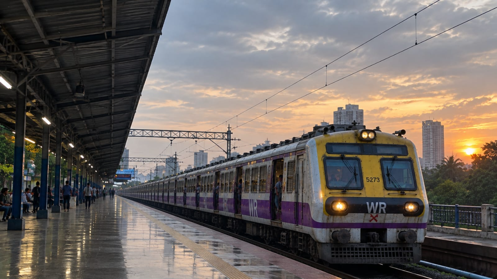
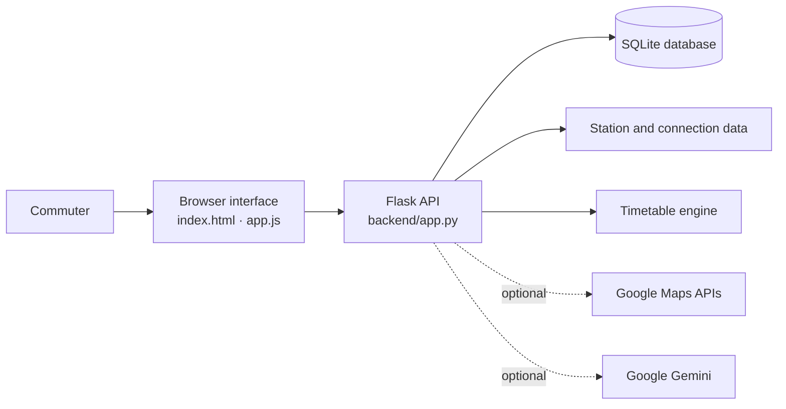

<div align="center">
  
  <h1>CentralSaathi</h1>
  <p><strong>A clearer way to explore Mumbai’s Central Line.</strong></p>
  <p>Route planning · Station connectivity · Train information · Commuter insight</p>
  <p>
    
    
    
    
  </p>
</div>

---

## The idea

Mumbai’s local network is part of everyday life for millions of people. CentralSaathi brings useful journey context into one place: explore stations and connections, compare train options, estimate fares, and find commuter information without jumping between separate tools.

The project focuses on the **Central Line**, connecting CSMT with the suburban corridors toward Kasara and Karjat. It combines a browser interface with a Python API, local data engines, and optional Google Maps and Gemini integrations.

<p align="center">
  
</p>

## What you can explore

| Capability | What it brings together |
|---|---|
| **Station and route discovery** | Search stations and explore route options, connections, and journey context. |
| **Train and timetable tools** | Search train options and look up first and last services when schedule data is available. |
| **Fare estimates** | Compare estimated fares between stations. |
| **Railway map experience** | Explore the line on a map; Google Maps route geometry is optional. |
| **Train movement view** | Follow live-style train movement and service context in the interface. |
| **Commuter reports and alerts** | Review railway updates and submit or verify crowd reports. |
| **Analytics** | Surface punctuality, delay, and network summaries through the analytics endpoints. |
| **AI travel assistant** | Ask a commuter question through the Gemini-powered endpoint when a key is configured. |

> **Data note:** schedule-backed results depend on the timetable dataset being present. The timetable engine looks for `server/data/official_timetable_data.json`; that file is not currently published on `main` or `data_f`.

## A quick look at the architecture



## Technology

- **Interface:** HTML, CSS, and JavaScript
- **API and application logic:** Python and Flask
- **Storage:** SQLite, with JSON-backed station and timetable inputs
- **Analytics:** Pandas, NumPy, Matplotlib, and Plotly
- **External integrations:** Google Maps and Gemini, both optional

## Run it locally

### Prerequisites

- Python 3.10 or newer
- Node.js and npm for the repository’s npm scripts
- Git

### 1. Get the code and create a virtual environment

```bash
git clone https://github.com/Manish-kumbhar07/central-saathi-mini-project-.git
cd central-saathi-mini-project-
python -m venv .venv
```

Activate the environment:

```bash
# macOS / Linux
source .venv/bin/activate
```

```powershell
# Windows PowerShell
.venv\Scripts\Activate.ps1
```

### 2. Install the Python packages

The current repository does not include a `requirements.txt`, so install the packages used by the Flask application directly:

```bash
python -m pip install flask python-dotenv numpy pandas matplotlib plotly requests beautifulsoup4
```

Install the Node packages used by the project scripts and frontend tooling:

```bash
npm install
```

### 3. Configure optional integrations

Copy `.env.example` to `.env` and add keys only for the services you plan to use.

```bash
# macOS / Linux / Git Bash
cp .env.example .env
```

```powershell
# Windows PowerShell
Copy-Item .env.example .env
```

| Variable | Used for | Required? |
|---|---|---|
| `VITE_GOOGLE_MAPS_API_KEY` | Browser map experience | Optional |
| `GOOGLE_MAPS_API_KEY` | Server-side Google route requests | Optional |
| `GEMINI_API_KEY` | AI assistant and schedule verification | Optional |
| `GEMINI_MODEL` | Gemini model selection | Optional; defaults in the application |
| `DJANGO_SECRET_KEY` | Separate Django scaffold only | Only if running that scaffold |

Restrict the browser Maps key to the app’s allowed referrers. Keep server credentials private and out of source control.

### 4. Start CentralSaathi

```bash
npm run dev
```

The `npm run dev` and `npm start` scripts launch Flask at **http://localhost:3000**. The repository also contains `server.js` as a separate Express entry point; it is not used by those npm scripts. You can start Flask directly:

```bash
python -m backend.app
```

## Data and branch layout

The station and connection datasets are maintained on the **`data_f`** branch:

- `data/central_line_stations.json`
- `data/central_line_connections.json`

To bring those two files into a local `main` checkout without switching branches:

```bash
git fetch origin data_f
git restore --source origin/data_f --worktree -- data/central_line_stations.json data/central_line_connections.json
```

The timetable engine separately expects `server/data/official_timetable_data.json`. Add a project-approved timetable dataset at that path to enable schedule-backed train results.

## API at a glance

The Flask app exposes JSON endpoints for the main commuter workflows.

| Method | Endpoint | Purpose |
|---|---|---|
| `GET` | `/api/health` | Check application health |
| `GET` | `/api/stations` | List stations |
| `GET` | `/api/route` | Find route options |
| `GET` | `/api/trains/search` | Search train options |
| `GET` | `/api/timetable/first-last` | Find first and last train options |
| `GET` | `/api/fare` | Estimate a fare |
| `GET` / `POST` | `/api/disruptions/crowd-reports` | Read or submit commuter reports |
| `GET` | `/api/analytics` | Retrieve network and service analytics |
| `POST` | `/api/ai/ask` | Ask the optional AI assistant |

Example:

```text
http://localhost:3000/api/route?origin=CSMT&destination=KYN
```

## Repository map

```text
.
├── backend/
│   ├── app.py                 # Flask API and local web entry point
│   ├── database.py            # SQLite setup and data access
│   ├── timetable_engine.py    # Train and route logic
│   ├── analytics_engine.py    # Service and network analytics
│   └── scrapers.py            # Railway advisory scraping
├── server/
│   ├── live_tracker.py        # Train position and movement logic
│   ├── live_trains_engine.py  # Train search and timetable engine
│   ├── route_engine.py        # Route planning logic
│   ├── timetable_importer.py  # Timetable import utilities
│   └── timetable_validator.py # Timetable consistency checks
├── public/assets/             # Railway illustrations and imagery
├── central_saathi_project/   # Separate Django scaffold
├── index.html                 # Browser interface
├── app.js                     # Frontend behavior
├── server.js                  # Separate Express entry point
├── app.py                     # Standalone analytics prototype
├── central_saathi.py          # Standalone Python app / CLI
├── package.json               # Project scripts
├── .env.example               # Safe environment-variable template
└── README.md
```

## The people behind it

CentralSaathi is a team effort, with work across the interface, API, backend, server engines, and railway data.

| Contributor | Focus |
|---|---|
| **Manish** | Frontend experience, API, and application integration |
| **Jayesh** | Backend and server-side engineering |
| **Arnav** | Server and data engineering, including train tracking, timetable tools, and route logic |
| **Viraj** | Station and connectivity data |

### Arnav’s contributions

Arnav’s work connects the train-service experience with the data behind it:

- `server/live_tracker.py` — train-position interpolation and movement logic
- `server/live_trains_engine.py` — train search and timetable engine
- `server/route_engine.py` — route-planning logic
- `server/timetable_importer.py` — timetable import utilities
- `server/timetable_validator.py` — timetable consistency checks
- Station and connection data work in collaboration with Viraj

Server and data work was developed collaboratively across the team.

## Project goals

- Make Central Line station and journey information easier to explore.
- Keep route, train, and fare tools in one commuter-focused interface.
- Connect data engineering with practical features people can understand.
- Build the project collaboratively and make each teammate’s contribution visible.

---

<div align="center">
  <strong>Built with care for Mumbai’s local-train commuters.</strong><br />
  CentralSaathi · Team project
</div>
